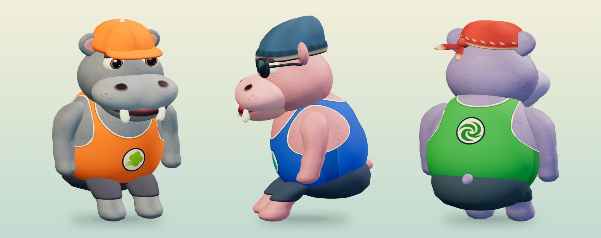
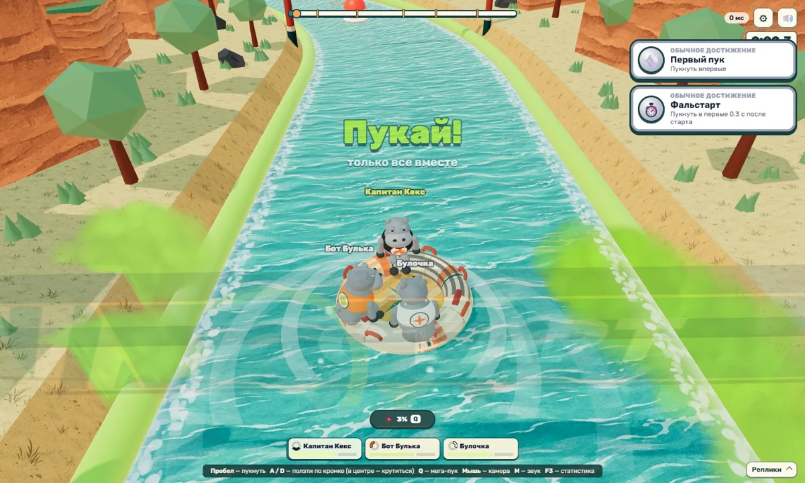

# Пукоплот

Кооперативная 3D-игра для 1–5 человек. Четыре бегемота ползают по кромке надувного плота, пятый сидит в центре. Чтобы разогнаться, газуйте вместе. Чтобы повернуть, договоритесь, кто в этот раз подвинется. Можно играть одному с ботами.


## Начать игру

**Windows x64.** Скачайте ZIP, распакуйте его целиком и откройте `Pukoplot.exe`. Рядом с ним должна быть папка `public`. Игра откроется в браузере. [Скачать сборку для Windows](https://github.com/ivang201/pukoplot/releases/latest/download/Pukoplot-Windows-x64.zip)

**Из исходников.** В корне проекта запустите команду под Node.js 24. Браузерные библиотеки, шрифты и картинки входят в репозиторий.

```sh
node server.mjs --no-browser
```

Откройте [игру на своём компьютере](http://localhost:3000). Друзьям в той же сети передайте адрес из окна сервера или лобби. Для другого порта используйте, например, `node server.mjs 4000 --no-browser`. Игрокам достаточно браузера с WebGL 2.

## Во что играть

- **Сплав.** Раскройте атлас в лобби и выберите одну из десяти трасс по рисованной открытке. На карточке указано время на медаль. В бесконечной реке и задании дня рекорд считают в метрах. Обходите камни и шипы, берегите газ и ловите момент для общего рывка.
- **Арена.** Двенадцать режимов. В «Утке на буксире» подойдите к утке на малой скорости и отведите её к своему причалу. Две доставки приносят победу. Раунд длится 90 секунд, реванш меняет команды берегами. В одиночку можно потренироваться. Для любителей мяча, гонок и охоты за бобами есть отдельные арены.
- **Гардероб.** Примерьте клубную майку, головной убор и очки. Кнопки «Спереди», «Сбоку» и «Сзади» поворачивают камеру вокруг вашего бегемота. Доступные вещи видны сразу, условия открытия остальных можно развернуть. Для собственных принтов положите PNG в папку `public/shirts`. [Инструкция по принтам](public/shirts/README.txt)





| Действие | Клавиатура и мышь |
| --- | --- |
| Дать газ | Удерживать пробел |
| Ползти по кромке или вращаться в центре | A / D или стрелки влево / вправо |
| Мега-пук при полном заряде | Q |
| Повернуть камеру, приблизить плот | Перетаскивание мышью, колесо |
| Звук, диагностика кадров и сети | M, F3 |

На телефоне левая половина экрана отвечает за движение по кромке, правая — за газ. Полные правила режимов, геймпада и бонусов есть в [руководстве игрока](ИНСТРУКЦИЯ.txt).

## Сервер и сохранения

Windows-сборка и Bun сохраняют прогресс в SQLite. При запуске через Node.js создаётся `pukoplot-db.json`. Каталог для сохранений задаёт `DATA_DIR`. Перед резервным копированием локальной базы остановите сервер.

Для постоянного сервера с PostgreSQL скопируйте `.env.example` в `.env`, задайте пароль и запустите `docker compose up -d --build`. Состояние сервера доступно по пути `/health`.

## Разработка

«Утка на буксире» уже доступна в лобби. Команда `node scripts/check-tow.mjs` проверяет захват, перехват, работу троса, обе стороны гавани и две доставки подряд. Дальнейшие режимы и способы проверить их с игроками собраны в [плане развития «Пукоплота»](docs/ROADMAP.md).

Сервер и браузер используют одни и те же модули физики в `public/sim.js`, `public/shared.js` и `public/arena.js`. Встречные струи раскачивают плот, боковой удар закручивает его, а течение продолжает нести экипаж после отпускания газа. Команда `node scripts/check-physics.mjs` проверяет разгон, снос, рикошеты трёх форм плота и расхождение между сервером и клиентским предсказанием. Сцену строит Three.js. Рисованные иллюстрации, материалы поверхностей и нашивки лежат в [public/art](public/art).

Для проверки первой трассы с неподвижной камерой откройте [осмотр стартовых ворот](http://localhost:3000/?view=0:6). Сборка Windows из зафиксированной версии исходников выполняется в PowerShell с Git и Bun 1.2.23 в PATH.

```powershell
.\scripts\package-windows.ps1
```

Лицензии сторонних компонентов входят в проект. [Three.js](public/vendor/three-LICENSE.txt) · [Rubik](public/fonts/Rubik-OFL.txt)
